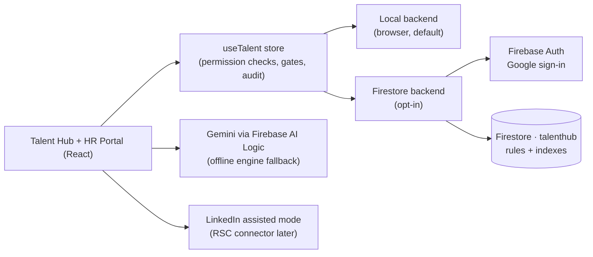

# Talent Hub · production kit (`talenthub` Firestore database)

> **Status: not provisioned.** Per the current decision, everything runs locally
> (browser storage + offline AI + LinkedIn assisted mode). Nothing in this folder
> has been executed. Follow the checklist below when you are ready for production.

The app already speaks the production data model: every Talent Hub document
(requisitions, candidates, applications, interviews, scorecards, offers,
outreach, onboarding journeys, activity) has the exact shape it will have in
Firestore, and every store action goes through one backend interface
(`src/talent/backend`). Going live is a configuration change, not a rewrite.



## What's in the kit

| File | Purpose |
| --- | --- |
| [`firestore.rules`](./firestore.rules) | Security rules: allowlist, team scoping, separation of duties, private sub-docs |
| [`firestore.indexes.json`](./firestore.indexes.json) | Composite indexes + index exemptions for large text fields |
| [`../firebase.json`](../firebase.json), [`../.firebaserc`](../.firebaserc) | Firebase CLI targets the named `talenthub` database in `csrm-nova-dev` |
| [`../scripts/talenthub-create-db.sh`](../scripts/talenthub-create-db.sh) | Enables APIs, creates the database (delete protection + PITR), deploys rules/indexes. **Dry run by default** |
| [`../scripts/talenthub-add-member.sh`](../scripts/talenthub-add-member.sh) | Adds a Google account to the allowlist (`members/{email}`) |
| [`../.env.example`](../.env.example) | Every switch: Firebase config, backend, demo seeding, Gemini, LinkedIn mode |
| `src/talent/backend/firestore.ts` | Adapter: Google sign-in, allowlist lookup, scoped pulls, access fields, private split |

## Go-live checklist

1. **Privacy review.** Candidate data is personal data (GDPR / UAE PDPL). Confirm the
   region (default `us-west1`, same as this project's other databases; `me-central1` is
   Doha), retention period and who may see compensation. Consent is already enforced
   by the pipeline gate *before* assessment.
2. **Create the database.**
   ```bash
   ./scripts/talenthub-create-db.sh            # review the plan
   ./scripts/talenthub-create-db.sh --apply    # creates talenthub + deploys rules/indexes
   ```
3. **Firebase web app + sign-in.** Firebase console → *Project settings → Your apps → Web*:
   copy the config into `.env.production.local` (template: `.env.example`).
   *Authentication → Sign-in method*: enable **Google**; add your hosting domain to
   *Authorized domains*.
4. **Allowlist.** Start with yourself, then add people by role:
   ```bash
   ./scripts/talenthub-add-member.sh maboud@google.com u-layla '*'
   ```
   `perms` are the member's effective NEXUS permissions (see the script header for
   recruiter / hiring manager / employee examples). Accounts not listed get nothing.
5. **Gemini.** Firebase console → *AI Logic* → enable the Gemini Developer API.
   Turn on **App Check** (reCAPTCHA Enterprise) to protect quota and add a budget alert.
   Model: `VITE_GEMINI_MODEL` (default `gemini-2.5-flash`). Matching stays deterministic
   and offline so rankings are explainable; Gemini decodes JDs and drafts outreach, with
   automatic fallback to the offline engine on any error or timeout (25 s).
6. **Switch the backend and build.**
   ```bash
   # .env.production.local
   VITE_TALENT_BACKEND=firestore
   VITE_TALENT_SEED_DEMO=false
   npm run build
   ```
   On first load users sign in with Google; the NEXUS session follows their allowlist
   entry. An empty database starts empty (demo data is only seeded when
   `VITE_TALENT_SEED_DEMO=true`, for staging).
7. **Smoke test.** Recruiter: create a requisition → source from a JD → add a candidate →
   log outreach → screen → scorecards → decision → offer (approved by two different
   people) → accept → onboarding journey appears in the HR Portal. Hiring manager: sees
   only their requisitions; compensation is redacted.
8. **Rollback** at any time: `VITE_TALENT_BACKEND=local` (the app keeps working offline).

## Data model (`talenthub`)

| Collection | Doc id | Notes |
| --- | --- | --- |
| `members` | email (lower-case) | Allowlist: `{ email, hubUserId, perms[], active }` |
| `requisitions` | `req-*` | JD text + decoded profile, interview plan, `panelIds`, `teamIds`; `private/data` = salary band |
| `candidates` | `c-*` | Talent pool, consent + retention, `teamIds`; `private/data` = email, phone, salary expectation |
| `applications` | `a-*` | One per candidate × requisition: stage, history, match explanation, decision |
| `interviews` | `iv-*` | Panel, time, location, status |
| `scorecards` | `sc-*` | Immutable once submitted; one per interviewer |
| `offers` | `of-*` | Two-step approval chain; `private/data` = base, bonus, equity, sign-on |
| `outreach` | `o-*` | LinkedIn connect / InMail / email drafts and sends, follow-up cadence |
| `onboarding` | `j-*` | HR Portal journeys: pre-boarding → day 1 → week 1 → 30/60/90 tasks |
| `activity` | `act-*` | Append-only hiring timeline (the NEXUS audit log records every action too) |

Timestamps are epoch milliseconds; calendar dates (start dates) are ISO `YYYY-MM-DD`.

**HR Portal data (phase 2).** Time off, benefits, claims, documents & letters, policy
acknowledgements, payslip records, pulse check-ins and People Ops cases (`src/hr/*`) use
the same document conventions and permission model (`src/hr/access.ts`, mirrored by the
`useHr` store) but stay in the browser for now. When you're ready, add their collections
to the backend adapter exactly like the Talent Hub ones; pay records and case threads
belong in `private` sub-documents.

## Security model

- **Who:** Google sign-in + `members/{email}` allowlist (`active`, effective `perms`).
- **Recruiters** (`talent.manage`) see every requisition. **Hiring managers**
  (`talent.hire`) see only requisitions where they are on the hiring team, via the
  derived `teamIds` field (queries use `array-contains`).
- **Separation of duties:** hiring managers can't approve their own headcount; offer
  drafters can't approve; each approval step needs a different person (four-eyes).
- **Compensation and contact details** live in `private/data` sub-documents, readable
  only with `talent.manage` or `talent.comp.view`.
- **Scorecards are immutable**; activity is append-only; nothing is hard-deleted except
  candidate erasure requests (recruiters).
- The same rules run client-side (`src/talent/access.ts`) so the UI never offers an
  action the database would reject.

Known limits: per-task ownership inside onboarding journeys is enforced by the app
(rules restrict *which fields* managers/buddies/new hires can change). `teamIds` are
maintained by the client adapter; if several systems write to the database, move that
logic into a Cloud Function trigger. To use Firestore TTL for retention, store
`retentionUntil` as a `Timestamp` (TTL ignores numbers).

## LinkedIn

**Today: assisted mode** (`VITE_LINKEDIN_MODE=assisted`), which keeps you inside
LinkedIn's terms: the AI turns a JD into a LinkedIn Recruiter Boolean, a one-click
people search and a Google X-ray query; drafts personalised connection notes /
InMails / emails within LinkedIn's limits (300 / 1,900 characters); you copy, send on
LinkedIn and log it. Profiles are imported from a URL or the profile's own
*More → Save to PDF* export, with a review step. The prospect feed in the Sourcing
studio is a **clearly labelled sample** so the flow works end-to-end without an API.

**Later: Recruiter System Connect** (`VITE_LINKEDIN_MODE=rsc`). Requires LinkedIn Talent
Solutions partner approval. Put the credentials in a server-side proxy (e.g. Cloud Run)
— never in the browser — and implement `search()` in
`src/talent/linkedin/connector.ts` against that proxy. The UI, ranking and outreach
flows stay unchanged.

## Privacy notes

- Consent (method + retention horizon) is recorded before assessment; the pipeline
  gate blocks the Screen stage without it.
- JD text is sent to Gemini when it's enabled; outreach drafting sends the candidate's
  name, title, company, location and skills. Use the offline engine
  (`VITE_TALENT_AI=offline`) if that isn't acceptable for a role.
- Generated sample people (`sample: true`) are fictional and never linked to real
  LinkedIn profiles.
